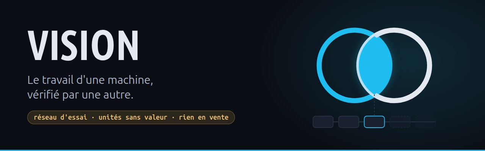
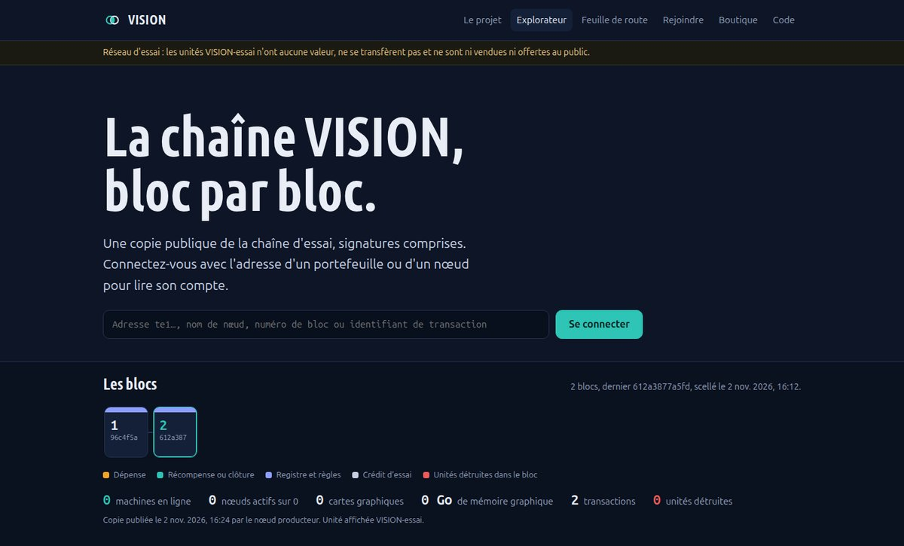
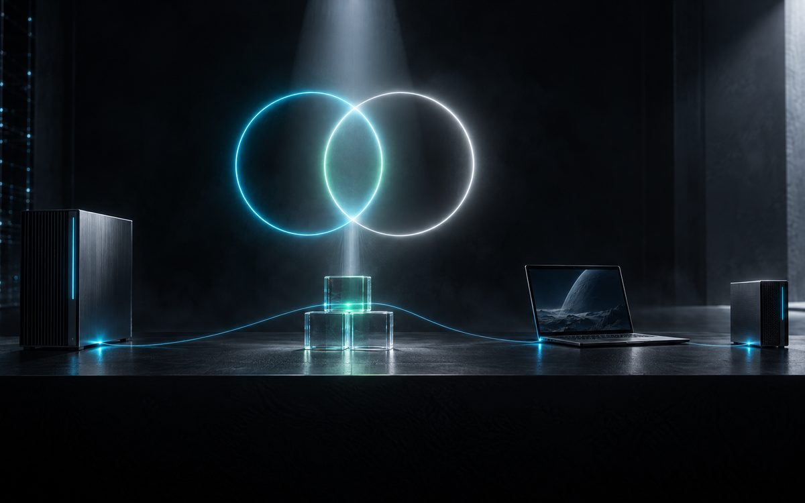
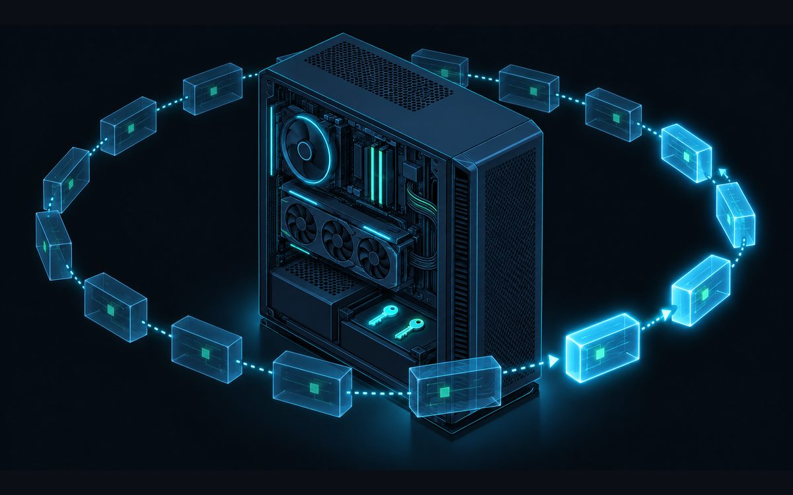

> *De l'ombre naît le travail. De la lumière naît la preuve.*

# VISION · nœud, portefeuille et partage de puissance (réseau d'essai)

> **Chaîne d'ESSAI.** Les unités n'ont aucune valeur, ne se transfèrent pas d'un compte à l'autre et ne sont ni vendues ni offertes au public.

VISION relie des machines équipées de cartes graphiques pour faire tourner des modèles d'IA en local. Chaque machine installe un **nœud** et son **portefeuille** ; le travail fait par une machine n'est récompensé qu'après avoir été **revérifié par une autre**.

| | |
|---|---|
| **Site du projet** | <https://turbo31150.github.io/vision/> |
| **Explorateur de blocs** (blocs, nœuds, connexion par adresse) | <https://turbo31150.github.io/vision/explorateur/> |
| **Feuille de route** | <https://turbo31150.github.io/vision/#feuille-de-route> |
| **Installer un nœud** (Linux, Windows, macOS, Android) | <https://turbo31150.github.io/vision/installer/> · [Installer](#installer) |
| **Vérifier la chaîne soi-même** | [Vérifier sans nous croire](#vérifier-sans-nous-croire) |

**En bref**
- **Un nœud en un fichier**, sans droits d'administrateur ; deux clés ed25519 créées et gardées sur la machine ; le logiciel ne les transmet jamais.
- **Un portefeuille de bureau**, servi uniquement sur la machine (`127.0.0.1`), avec connexion par adresse.
- **Une chaîne signée, rejouée par chaque nœud** depuis le bloc 0 ; un vérificateur indépendant la rejoue sans le code du nœud.
- **La puissance mise en commun** : chaque machine annonce ses cartes, sa mémoire et sa charge ; les annonces sont signées puis additionnées. C'est une puissance déclarée : aucune attestation matérielle n'est encore en place.
- **Des points sur preuve, en simulation** : un travail ne compte qu'avec le reçu signé d'une autre machine. Aucune récompense n'est émise : le budget est fictif, non convertible et ne donne droit à aucun paiement.


*L'ombre produit, la lumière vérifie ; là où les deux anneaux se croisent, le travail devient une preuve. Illustration générée par IA (Manus).*

## Ce que contient ce dépôt

| Dossier | Rôle |
|---|---|
| `noeud/vision-noeud` | Le nœud : rejoue et vérifie la chaîne, échange avec ses pairs, lit le miroir public, sert le portefeuille sur `127.0.0.1` |
| `noeud/ui/` | Le portefeuille de bureau : solde, dépenses signées, compte par adresse, partage de puissance, réseau, blocs |
| `chaine/vision-chaine` | Les règles de la chaîne : blocs signés, racines de Merkle, soldes, dépenses (20 % détruits), forfaits, époques de récompense |
| `installateur/` | Les modèles des installateurs (bash : Linux, macOS, Android ; PowerShell : Windows) et leur constructeur reproductible |
| `outils/exporter-chaine-publique` | Ce que le nœud producteur publie dans `docs/chaine/` (le miroir) |
| `docs/` | Le site du projet, la page Installer, l'explorateur, le miroir de la chaîne et les installateurs |

## Vérifier sans nous croire


*Capture réelle de l'explorateur.*

`outils/verifier-chaine` rejoue toute la chaîne publiée sans utiliser le code du nœud : liens, racines de Merkle, soldes, signatures, changements de clé. Il ne demande que Python 3.10 et `ssh-keygen`.

```bash
python3 outils/verifier-chaine docs/chaine --cle-origine "ssh-ed25519 AAAA..."
```

Sans `--cle-origine`, la clé vient du même site que les blocs : cela prouve la cohérence, pas l'origine. Obtenez cette clé par un autre canal.

## Installer

Un nœud et son portefeuille de bureau s'installent dans le dossier de l'utilisateur, sans droits d'administrateur. Il faut Python 3.10 ou plus récent et `ssh-keygen`. Deux installateurs, une seule archive de code, les mêmes valeurs épinglées (clé du producteur, bloc 0) : `installer-noeud-vision.sh` pour Linux, macOS et Android (Termux), `installer-noeud-vision.ps1` pour Windows. La page [Installer](https://turbo31150.github.io/vision/installer/) reprend ces commandes système par système.

| Système | État |
|---|---|
| Linux | testé le 2 novembre 2026 (installation, lecture du miroir, chaîne rejouée) |
| Windows 10 et 11 | non testé sur ce système |
| macOS | non testé sur ce système |
| Android (Termux) | non testé sur un téléphone |

**Linux** (service `systemd --user`, icône « VISION Portefeuille » du menu) :

```bash
curl -LO https://turbo31150.github.io/vision/installer-noeud-vision.sh
curl -LO https://turbo31150.github.io/vision/installer-noeud-vision.sh.sha256
sha256sum -c installer-noeud-vision.sh.sha256
less installer-noeud-vision.sh            # un script shell, suivi d'une archive du code de ce dépôt
bash installer-noeud-vision.sh --nom mon-noeud
```

**Windows 10 et 11**, dans PowerShell (Python depuis python.org ou le Microsoft Store, « Client OpenSSH » de Windows ; la comparaison doit afficher `True`). Le nœud tourne sans fenêtre (`pythonw`), une tâche planifiée le démarre à l'ouverture de session, un raccourci « VISION Portefeuille » est posé dans le menu Démarrer et sur le Bureau :

```powershell
curl.exe -LO https://turbo31150.github.io/vision/installer-noeud-vision.ps1
curl.exe -LO https://turbo31150.github.io/vision/installer-noeud-vision.ps1.sha256
(Get-FileHash .\installer-noeud-vision.ps1 -Algorithm SHA256).Hash -eq (Get-Content .\installer-noeud-vision.ps1.sha256).Split(' ')[0]
powershell -NoProfile -ExecutionPolicy Bypass -File .\installer-noeud-vision.ps1 -Nom mon-pc
```

**macOS** (Python 3.10 ou plus récent depuis python.org, puis « Install Certificates.command », ou `brew install python`). Un agent de session launchd démarre le nœud ; l'application « VISION Portefeuille » est posée dans `~/Applications` :

```bash
curl -LO https://turbo31150.github.io/vision/installer-noeud-vision.sh
curl -LO https://turbo31150.github.io/vision/installer-noeud-vision.sh.sha256
shasum -a 256 -c installer-noeud-vision.sh.sha256
bash installer-noeud-vision.sh --nom mon-mac
```

**Android, avec Termux** (Termux et Termux:Widget depuis F-Droid ou GitHub, pas depuis le Play Store). Le nœud tourne en arrière-plan ; le raccourci `~/.shortcuts/VISION Portefeuille` du widget le relance au besoin et ouvre le portefeuille :

```bash
pkg install python openssh curl
curl -LO https://turbo31150.github.io/vision/installer-noeud-vision.sh
curl -LO https://turbo31150.github.io/vision/installer-noeud-vision.sh.sha256
sha256sum -c installer-noeud-vision.sh.sha256
bash installer-noeud-vision.sh --nom mon-telephone
termux-wake-lock                          # Android n'arrête plus Termux en arrière-plan
```

Ensuite :

1. Le portefeuille s'ouvre par l'icône « VISION Portefeuille » ou par la commande affichée à la fin de l'installation ; l'adresse `http://127.0.0.1:8861/` seule donne une lecture sans signature. Deux clés ed25519 ont été créées sur votre machine, une pour le nœud et une pour le portefeuille ; elles ne la quittent jamais.
2. Le nœud lit la chaîne sur le miroir public et la **rejoue entièrement** depuis le bloc 0, avec la clé du producteur épinglée dans l'installateur. Un miroir ne peut rien lui imposer.
3. Onglet **Mon compte** : connectez-vous avec une adresse (`te1…`) pour voir ce que la chaîne sait d'elle : solde, forfait d'essai, dépenses, nœuds rattachés, matériel partagé et unités reçues.
4. Onglet **Nœud** → **Préparer ma demande d'inscription** : une transaction signée par la clé de votre nœud (données publiques seulement) s'ouvre en ticket sur ce dépôt. Le producteur l'importe et votre nœud entre au registre.

Désinstaller : `bash installer-noeud-vision.sh --desinstaller` sous Linux, macOS et Android ; `powershell -NoProfile -ExecutionPolicy Bypass -File .\installer-noeud-vision.ps1 -Desinstaller` sous Windows. Les clés restent (`~/.local/share/vision-noeud`, ou `%LOCALAPPDATA%\VISION\noeud` sous Windows).

### Vérifier l'installateur vous-même

Les deux installateurs se reconstruisent à l'identique à partir de ce dépôt, sous Linux ; la clé publique du producteur et l'empreinte du bloc 0 sont lues dans `docs/chaine/info.json` :

```bash
installateur/construire-installateur
cat docs/installer-noeud-vision.sh.sha256 docs/installer-noeud-vision.ps1.sha256
```

## Comment ça marche, pas à pas


*Illustration générée par IA (Manus).*

**1. Des machines ordinaires, reliées.** Un PC de bureau ou un portable sous Linux, avec ou sans carte graphique, suffit. Chaque machine installe un nœud : il garde une copie de la chaîne, parle aux autres nœuds et sert le portefeuille. Une seule machine, le producteur, signe aujourd'hui les blocs ; les autres rejouent tout ce qu'il publie au lieu de le croire.


*Illustration générée par IA (Manus).*

**2. Installer : un fichier, deux clés qui ne sortent jamais.** L'installateur crée deux clés ed25519 dans `~/.local/share/vision-noeud`, une pour le nœud et une pour le portefeuille. Le portefeuille n'est servi que sur la machine (`http://127.0.0.1:8861/`) : seul votre compte peut signer, grâce à un secret local lisible par vous seul.


*Illustration générée par IA (Manus).*

**3. Rejouer toute la chaîne avant d'y croire.** Le nœud récupère la chaîne chez ses pairs du réseau local ou sur le miroir public, puis la rejoue depuis le bloc 0. Pour chaque bloc, il vérifie la hauteur, l'empreinte du bloc précédent, la racine de Merkle des transactions, l'empreinte des soldes et la signature du producteur (`ssh-keygen -Y`, espace dédié), avec la clé épinglée dans l'installateur. Au premier écart, la copie est refusée.


*Illustration générée par IA (Manus).*

**4. Mettre la puissance en commun.** Chaque nœud annonce sa machine (cartes, mémoire, cœurs, charge), signée par sa clé. Les annonces sont vérifiées puis additionnées ; une machine n'est comptée en ligne que si elle a répondu dans les deux dernières minutes. VISION n'exécute rien lui-même : les modèles d'IA tournent sur les machines, VISION recense la puissance et inscrit les preuves du travail fait.


*Illustration générée par IA (Manus).*

**5. Le travail d'une machine, vérifié par une autre.** Quand une machine termine une étape, une autre la rejoue et signe un reçu : réussi, échoué ou indéterminé. Sans reçu, pas de point.
- Points de travail : les secondes de l'étape validée, doublées si le résultat est retrouvé à l'identique.
- Points de vérification : un point par reçu signé, pour la machine qui a vérifié.
- Par époque hebdomadaire (frontière le mercredi 12:00 UTC), le budget se partage au prorata des points et le reliquat reste en réserve. Ce budget est divisé par deux chaque année : c'est une règle de calcul, pas une promesse de gain.
- Pour l'instant, les récompenses restent calculées en simulation.

**6. Les unités d'essai.** Un service rendu par le réseau se règle par une dépense signée par le portefeuille : 20 % sont détruits, 80 % reviennent à la réserve qui récompense les machines. Il n'existe aucune instruction de transfert entre comptes. Seules des factures d'essai `ESSAI-` créditent des unités : aucune somme n'est encaissée.

La vérification des reçus de travail s'appuie sur un module privé du producteur, qui n'est pas publié ici. Sans lui, un nœud vérifie tout le reste : liens, racines, signatures, soldes, règles et clôtures d'époque.

## Limites connues

- Un seul producteur de blocs (preuve d'autorité). Trois témoins répliquent le grand livre, mais ils tournent pour l'instant sur des machines du même propriétaire.
- Transport entre nœuds en HTTP simple : les blocs et les transactions sont signés, le transport n'est pas chiffré. Pas de traversée de box (NAT) : hors du réseau local, un nœud lit le miroir public.
- Pas d'audit indépendant. Une relecture contradictoire a relevé des faiblesses, dont le rejeu possible d'une dépense déjà scellée et l'absence de limite sur la taille des requêtes entre nœuds. Ces deux points sont corrigés dans ce dépôt, sans audit extérieur à ce jour. La chaîne publique ne contient à ce jour aucune dépense.
- Un reçu signé prouve quelle machine déclare avoir rejoué une étape, pas que le calcul a eu lieu ; le rejeu par une autre machine n'est complet que pour les étapes déterministes.
- Compter des secondes de calcul reste une mesure approchée du travail.

## Feuille de route

- **Fait** : chaîne d'essai signée, nœud et installateur en un fichier, portefeuille de bureau avec connexion par adresse, partage de puissance, règles de récompense par époque, explorateur public, vérificateur indépendant.
- **Prochain, date à fixer** : première clôture d'époque recalculée par chaque nœud, seulement avec des reçus vérifiables par tous.
- **À construire** : témoins tenus par d'autres propriétaires (points de contrôle au format C2SP et rotation de clé : écrits et testés, pas encore en service), chiffrement du transport, traversée des box, inscription sans intervention manuelle.
- **Conditionnel** : un usage réel ne s'envisage que si les conditions réglementaires sont réunies et prouvées. D'ici là, rien n'est en vente.

Les critiques et les questions sont bienvenues : ouvrez un ticket.
